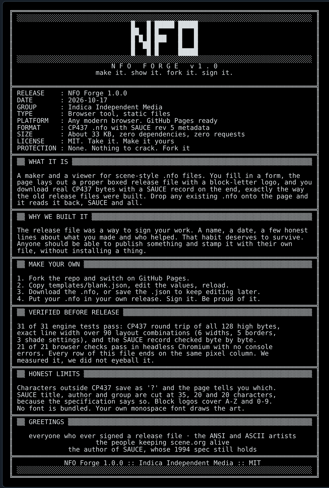

# NFO Forge

Make, show and sign your own `.nfo` release file. Fork it, edit one JSON file, host it free on GitHub Pages.

The `.nfo` was the little text file that came with a release in the 1990s: a boxed block-letter logo, a name, a date, a few honest lines about what it was and who made it. This tool builds that file properly. You get real CP437 bytes and a SAUCE metadata record on the end, the way the originals were made, and it opens any existing `.nfo` and reads the SAUCE back.



## Use it

1. Fork this repo.
2. Settings, Pages, deploy from the `main` branch root.
3. Open your Pages URL. Edit the form, or load a template.
4. Download the `.nfo`, or save the `.json` so you can keep editing it later.

No build step, no dependencies, no tracking. Nothing you type leaves your browser. Open `index.html` over any static server to run it locally, for example `python3 -m http.server`.

## Make it yours

Everything about your release lives in one JSON file. Copy `templates/blank.json`, change the values, and load it from the page or link straight to it with `?t=your-file` (the file must be in `templates/` and use lowercase letters, digits and hyphens).

| Key | What it does |
|---|---|
| `width` | 40 to 120 columns. 79 is the classic. |
| `border` | `double`, `single`, `block`, `ascii`, `none` |
| `shade` | `light`, `medium`, `dark`, `full`, `none` bars above and below the logo |
| `logo` | Block-letter logo, A to Z and 0 to 9. Falls back to plain text, with a warning, if it does not fit. |
| `title`, `tagline`, `footer` | Centered lines |
| `fields` | `[["Label", "value"], ...]`, wrapped and aligned |
| `sections` | `[{"heading": "...", "body": "..."}]` or `{"heading": "...", "lines": [...]}` for hand-wrapped text |
| `greets` | A list. Each name stays whole on its line. |
| `sauce` | `title` (35 max), `author` (20), `group` (20), `date` as `YYYYMMDD`, `comments` (64 per line) |

The official 2026 release file for this project is `templates/release-2026.json`. Open it with `?t=release-2026`.

Templates that ship with it:

| Open with | What it is |
|---|---|
| `?t=blank` | The generic starting point. |
| `?t=release-2026` | The release file for NFO Forge itself. |
| `?t=iim` | The Indica Independent Media release file, 79 columns. |
| `?t=iim-mini` | The compact 46-column badge shown on the profile page. |

The finished `.nfo` files and dark and light images are in `docs/`.

## What it guarantees, and what it does not

- **Every line is exactly as wide as you asked.** The renderer checks this and reports any line that is not.
- **Nothing is dropped silently.** Characters outside CP437 are saved as `?` and the page lists them. Text that is too long is wrapped or cut with a visible warning.
- **The SAUCE record follows the ACiD revision 5 layout:** an EOF byte `0x1A`, an optional `COMNT` block, then a 128-byte record.
- **Limits.** The block logo covers A to Z, 0 to 9, hyphen, full stop and exclamation mark. SAUCE title, author and group are cut at 35, 20 and 20 characters because the specification says so.
- **No font is bundled.** The preview uses your own monospace font. Install a pixel font such as Px437 IBM VGA from [The Ultimate Oldschool PC Font Pack](https://int10h.org/oldschool-pc-fonts/) (CC BY-SA 4.0) if you want the authentic look, and the page will pick it up by name.

## Tests

```
node test.js
```

Runs the engine tests: the CP437 table over all 128 high bytes, exact line width across widths, borders and shades, word wrap that never loses a character, greeting packing, and the SAUCE record checked byte by byte. The browser layer is exercised separately in a headless browser before each release.

## A short history, and what this is not

A release file (`.nfo`) was the text file a scene group put inside every release: a block-letter logo in the group's colours, then the name of the release, the date, who supplied it and a few lines of notes. The form is much older than any one group, and it is still used. The ACiD artpacks that gave us SAUCE in 1994 used it for art, not software.

Some of the best known groups that used the format were piracy groups. DrinkOrDie, for example, was founded in Russia in 1993 and was dismantled in December 2001 by Operation Buccaneer, according to the [US Department of Justice](https://www.justice.gov/archive/opa/pr/2007/June/07_crm_444.html). This project borrows only the look of the file: the box, the logo, the field list, the greetings. It has no connection to any scene group, contains no group's artwork, and is not for distributing anyone else's software. Use it to sign your own work.

## Credits

SAUCE was designed by Olivier "Tasmaniac" Reubens of ACiD in 1994. This project implements the [revision 5 specification](https://www.acid.org/info/sauce/sauce.htm). The block-letter font and all code here are original to this project.

MIT licensed.
